<p align="center">
  
</p>

<p align="center">
  <b>Built on backend. Bringing AI to everyday life.</b>
</p>

## 💻 Dev Session

<p align="center">
  
</p>

- [📈 **Alpha Twin ↗**](https://github.com/Kim-Ji-Won/Alpha_Twin) — AI 투자 인텔리전스
- [⚙️ **Axiom ↗**](https://github.com/Kim-Ji-Won/Axiom_Reliable-Agent-Runtime) — Reliable Agent Runtime
- [🔮 **AETHER ↗**](https://github.com/Kim-Ji-Won/AETHER) — macOS AI Assistant

<sub>🚧 In development</sub>

## 🛠️ Working Stack

<p>
  
</p>

## 🎯 Current Focus

```text
⚙️ Backend    API Design · PostgreSQL · Reliability
🧠 AI         Agent Runtime · LLM · RAG
🖥️ Desktop    Tauri · React · macOS
```

## 👾 Commit Arcade

<picture>
  <source media="(prefers-color-scheme: dark)" srcset="https://raw.githubusercontent.com/Kim-Ji-Won/Kim-Ji-Won/output/pacman-contribution-graph-dark.svg" />
  <source media="(prefers-color-scheme: light)" srcset="https://raw.githubusercontent.com/Kim-Ji-Won/Kim-Ji-Won/output/pacman-contribution-graph.svg" />
  
</picture>

<p align="center">
  <b>Build. Understand. Document.</b><br/>
  <sub>Made with <a href="https://github.com/ryanpolasky/ryme.md">RyMe.md</a> · <a href="https://github.com/abozanona/pacman-contribution-graph">Arcade Contribution Graph</a></sub>
</p>
