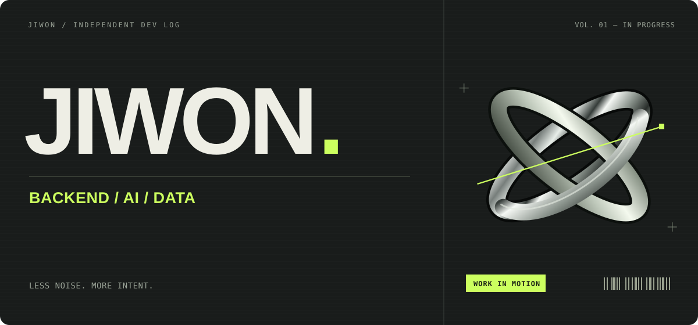

  

백엔드 개발을 중심으로 **AI와 데이터를 신뢰할 수 있는 서비스로 연결하는 방법**을 탐구합니다.  
프로젝트를 만들며 배우고, 구현 과정의 문제와 설계 이유를 기록합니다.

### Current Focus

**Backend systems** &nbsp; / &nbsp; **Data engineering** &nbsp; / &nbsp; **Applied AI**

API와 데이터 모델링, 공시 데이터의 품질, 검색과 분석의 근거를 다루는 데 관심이 있습니다.

---

### Selected Work

#### Alpha Twin &nbsp; · &nbsp; IN DEVELOPMENT

기업 공시와 재무 데이터를 바탕으로 기업을 이해하고, 분석의 근거를 추적하는 **AI 투자 인텔리전스 서비스**를 개발하고 있습니다.

| Layer | Engineering focus |
| :--- | :--- |
| **Backend & Data** | Fastify API · OpenDART 연동 · 재무 데이터 정규화 |
| **AI & Retrieval** | 공시 문서 처리 · 임베딩과 검색 · 근거 기반 분석 구조 개발 |
| **Mobile** | React Native · Expo 기반 인터페이스 |

로컬에서 개발 중 · GitHub 소스 공개 준비 중

#### [LLM System Lab ↗](https://github.com/Kim-Ji-Won/LLM-System-Lab)

LLM 학습, Transformer, 추론, RAG를 연결해서 이해하기 위한 인터랙티브 시각화.  
**React · TypeScript · SVG**로 AI 시스템의 구조를 탐색하는 학습 프로젝트입니다.

---

### Working Stack

  

현재 프로젝트에서 사용하는 기술을 중심으로 정리했습니다.

### Learning Log

**Backend** — API Design, Database Modeling, Testing  
**AI & Data** — LLM Fundamentals, RAG, Retrieval Evaluation

작은 실험부터 프로젝트의 설계 결정까지, 배운 내용을 코드와 기록으로 남겨갑니다.

---

JIWON &nbsp; / &nbsp; Build carefully. Keep learning.
