<p align="center">
  
</p>

<p align="center">
  <a href="https://github.com/DenverCoder1/readme-typing-svg"></a>
</p>

<p align="center">
  <b>백엔드에서 시작해, AI를 일상으로.</b><br/>
  <sub>Backend Engineering · Agent Systems · Learning by Building</sub>
</p>

## 🚀 Building Now

| Project | What I'm building |
| :--- | :--- |
| [📈 **Alpha Twin**](https://github.com/Kim-Ji-Won/Alpha_Twin) | 기업 공시·재무 데이터와 AI를 연결하는 투자 인텔리전스 |
| [⚙️ **Axiom**](https://github.com/Kim-Ji-Won/Axiom_Reliable-Agent-Runtime) | AI 에이전트의 실행 상태와 제어를 다루는 백엔드 런타임 |
| [🔮 **AETHER**](https://github.com/Kim-Ji-Won/AETHER) | 한국어 음성 대화와 컴퓨터 작업을 목표로 하는 macOS AI Assistant |

<sub>🚧 모두 개발 중 · Axiom은 런타임 기반 구현, AETHER는 초기 데스크톱 프로토타입 단계</sub>

## 🪐 Code Universe

<p align="center">
  
</p>

## 🛠️ Working Stack

<p>
  
</p>

## 🎯 Current Focus

```text
⚙️ Backend    API Design · PostgreSQL · Reliability
🧠 AI         Agent Runtime · LLM · RAG
🖥️ Desktop    Tauri · React · macOS
```

## 👾 Commit Arcade

<picture>
  <source media="(prefers-color-scheme: dark)" srcset="https://raw.githubusercontent.com/Kim-Ji-Won/Kim-Ji-Won/output/pacman-contribution-graph-dark.svg" />
  <source media="(prefers-color-scheme: light)" srcset="https://raw.githubusercontent.com/Kim-Ji-Won/Kim-Ji-Won/output/pacman-contribution-graph.svg" />
  
</picture>

<p align="center">
  <b>Build. Understand. Document.</b><br/>
  <sub>Made with <a href="https://github.com/DenverCoder1/readme-typing-svg">Typing SVG</a> · <a href="https://github.com/nimaldanyathk/repo-verse">RepoVerse</a> · <a href="https://github.com/abozanona/pacman-contribution-graph">Arcade Contribution Graph</a></sub>
</p>
